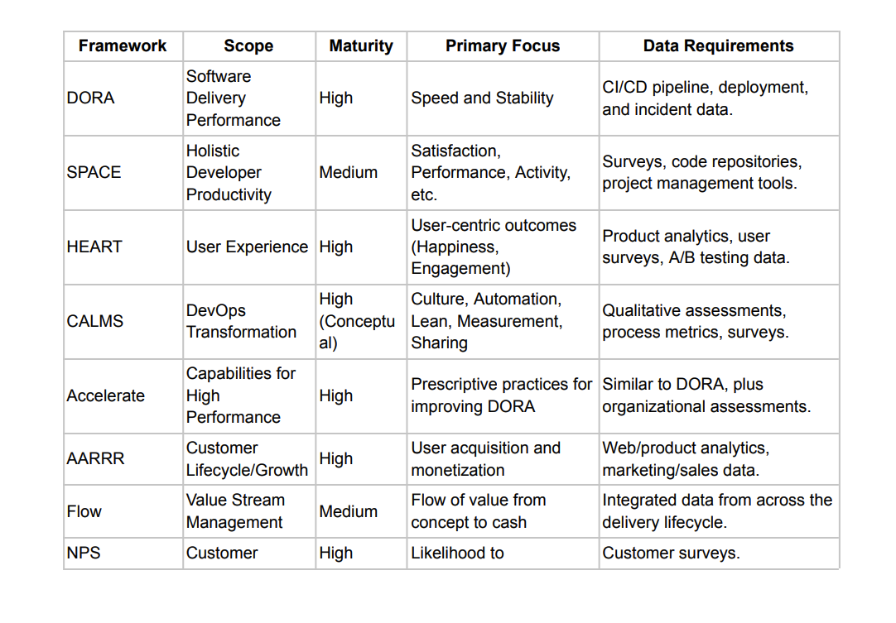
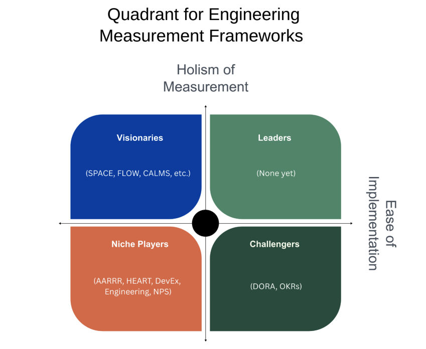

# G073 — Comparative Analysis of Engineering Performance and Experience Frameworks: DORA, SPACE, HEART, and Beyond

**Author/Organization:** Adeeb N Valiulla (Harness)
**Type:** Industry comparative analysis
**Year:** 2025
**URL:** https://papers.ssrn.com/sol3/papers.cfm?abstract_id=5335258
**File:** P_NEW_1_ssrn-5335258.pdf

> Blind coding: fill in only from the source text, without consulting Claude/NotebookLM.

---
## RECORD (spreadsheet fields — fill in after the colon)

- Relevance [Include/Exclude/Unsure]: Include
- Exclusion Reason (only if Exclude): 
- Primary or Secondary [Primary/Secondary]: Secondary
- GL Type: Article
- DORA Applied [Yes/No]: Yes
- SPACE Applied [Yes/No]: Yes
- AI Discussed [Yes/No]: Yes
- Mentions Remote/COVID [Yes/No]: No
- Data time window (e.g., 2018–2019 / not reported / review coverage): NDA

Metric categories:
- Productivity/Performance [Yes/No]: Yes
- Quality [Yes/No]: Yes
- Collaboration [Yes/No]: Yes 
- Satisfaction/Wellbeing [Yes/No]: Yes
- Activity/Code [Yes/No]: Yes
- Delivery Performance [Yes/No]: Yes 
- DevEx Dimensions [Yes/No]: Yes
- Agile/Process [Yes/No]: Yes
- Survey/Perceptual [Yes/No]: Yes

- Confidence [High/Medium/Low]: Low
- Quality Score [1–6, mean of the 6 AACODS/Garousi criteria; min 3.0]: 3

---
## DETAIL (free text)

### Pandemic / remote work (elaborate)
- 

### Evidence (quotes with section/page) — required
- "This paper provides a comprehensive comparative analysis of the
most prominent measurement frameworks: DORA, SPACE, HEART, CALMS, Accelerate,
AARRR Metrics, the Flow Framework, OKRs, and others. For each framework, we present its
definition, origins, key metrics, and a detailed SWOT analysis. A comparative matrix and a novel
Magic Quadrant for Engineering Measurement Frameworks synthesize the analysis, mapping
each framework based on its Holism of Measurement and its Ease of Implementation." - Resume

- "Looking forward, we identify critical
gaps in existing models and explore the future of engineering measurement, including the
impact of AI-driven analytics and the move toward integrated socio-technical system views. "

- "Analysis of the Magic Quadrant
Challengers: Frameworks in this quadrant are strong in their ease of implementation
and actionability but have a more focused, less holistic scope.
● DORA / SDPM: The quintessential challenger, providing four clear, actionable metrics for
software delivery performance. Its strength is its simplicity and prescriptive nature.
● OKRs: Positioned here because when implemented well, OKRs are a highly actionable
framework for aligning teams. However, they are a goal-setting system, not a
measurement framework itself, and thus their holism depends entirely on the metrics
chosen for the Key Results.
Visionaries: These frameworks offer a comprehensive, holistic vision for measurement
but can be more challenging to implement.
● SPACE: The most prominent visionary, explicitly calling for a balanced view that includes
developer well-being. Its conceptual nature makes implementation complex.
● Flow Framework: Provides a powerful end-to-end view of value delivery but requires
significant data integration and process maturity.
● Accelerate: While it produces the DORA metrics, the Accelerate framework itself is
visionary. It describes 24 underlying capabilities, which represent a holistic program of
cultural and technical change that is far more complex to implement than simply tracking
the four key metrics.
● CALMS: A high-level strategic model for transformation. Its vision is deeply holistic, but it
is the least prescriptive of all frameworks.
Niche Players: These frameworks are highly effective for specific, targeted purposes
but are not intended as comprehensive engineering performance systems.
● HEART & AARRR & NPS: These are powerful but highly focused frameworks for
measuring user experience, business growth, and customer loyalty, respectively. They
are crucial inputs but not a complete picture.
● DevEx Metrics & Engineering Effectiveness: These are not single frameworks but
bespoke collections of metrics. They are placed here because they are often
implemented to solve a specific, niche problem (e.g., "our build times are too slow")
rather than as a broad, strategic measurement initiative."

- "No single framework provides a complete picture of engineering performance. The most
effective measurement strategies often involve a combination of frameworks.
● DORA and SPACE. These two frameworks are highly complementary. DORA provides
the "what" (the performance of the delivery system), while SPACE offers a lens for the
"why" (the human and collaborative factors). An organization might use DORA to identify
a slowdown and then use SPACE to investigate whether the cause is developer burnout
(Satisfaction) or communication breakdowns (Communication and Collaboration).
● Flow Framework and DORA. The Flow Framework can be seen as a superset of some
DORA concepts. DORA's "Lead Time for Changes" is similar to "Flow Time." However,
the Flow Framework provides a more granular view by categorizing work. An
organization could use DORA as a high-level dashboard and the Flow Framework for
deeper analysis.
● HEART and Engineering Metrics (DORA, SPACE). HEART provides the crucial link
between engineering activities and user impact. A team might have excellent DORA
metrics but declining HEART metrics, indicating they are efficiently delivering the wrong
things. Combining these ensures engineering is both efficient and effective.
● OKRs as an Overarching Framework. OKRs can serve as the connective tissue that
aligns all other measurement efforts. A company-level OKR to "Increase Customer
Delight" could be supported by a product team OKR focused on HEART metrics and an
engineering team OKR focused on DORA metrics.
Conflicts can arise when frameworks are implemented in silos or when metrics are
treated as targets (Goodhart's Law). For example, a narrow focus on increasing Deployment
Frequency (DORA) without considering developer well-being (SPACE) could lead to burnout
and lower quality."

- "Choosing and combining frameworks should be a deliberate process based on an
organization's specific context, goals, and maturity.
1. Start with Why. Before adopting any framework, be clear about what you are trying to
achieve. Are you trying to improve the speed and reliability of your deployments? Are
you concerned about developer burnout? Is your primary goal to improve user
satisfaction? Your goals will determine which frameworks are most relevant.
2. Begin with a Balanced Set. Avoid measuring everything. A good starting point is to
combine a measure of delivery performance (DORA), developer well-being (a simple
survey, as a precursor to SPACE), and user impact (HEART or NPS).
3. Use Frameworks as a Guide, Not a Dogma. Adapt frameworks to your specific
context. You may not need to implement every metric in a given framework.
4. Foster a Culture of Psychological Safety. The success of any measurement program
depends on a culture where data is used for learning, not blame. As highlighted by
Valiulla (2025c), a culture of safety is a prerequisite for high performance.
5. Evolve Your Measurement System Over Time. Start with a simple set of metrics and
add more sophisticated measures as your organization's data-driven decision-making
capabilities mature."

- "Implementation Strategies
1. Start with a Cross-Functional Team: The initiative should not be driven solely by
engineering. Involve representatives from product, project management, and even
finance to build a shared understanding of what is being measured and why.
2. Define a "Paved Path": For larger organizations, the platform engineering team can
create a "paved path"—a supported stack of tools and CI/CD pipelines that automatically
collect key metrics (like DORA). This lowers the barrier to entry for teams and ensures
consistency.
3. Use Metrics as a Conversation Starter: The goal of a dashboard is not to provide all
the answers but to prompt better questions. Present metrics at team retrospectives and
use them to spark discussions about what is helping or hindering their work.
4. Balance Quantitative with Qualitative: Supplement metrics with qualitative data. A
drop in Deployment Frequency (DORA) is more meaningful when paired with developer
survey feedback (SPACE) indicating frustration with a new testing process."

- "his paper provides a conceptual and comparative analysis, not an empirical one. The
placement of frameworks within the Magic Quadrant is based on a synthesis of existing
literature and industry expertise, not on a quantitative survey of organizations. The field of
engineering measurement is also rapidly evolving; the frameworks and their supporting
toolchains will undoubtedly mature, potentially altering their strategic positioning. Furthermore,
the effectiveness of any framework is highly context-dependent, influenced by an organization's
size, maturity, culture, and business goals. This analysis provides a map, but the journey of
implementation will be unique for every organization."

### Quality (AACODS/Garousi — score each criterion 1–6; score = mean; min 3.0/6.0)
- Authority of author/organization: 3
- Rigor of methodology description: 3
- Currency / date of publication: 3
- Objectivity and declared commercial interest: 3 
- References to external evidence: 3
- Novelty of contribution: 3

### Free notes
- Its a good resume of all frameworks and metrics that shows the included trade-offs.
- 
### Frameworks Mentioned (validado 2026-07-16)
- DORA=Yes (applied); SPACE=Yes (applied); DevEx=Yes (referenced; confirmed by the author + 6 hits in the PDF of P_NEW_1)
