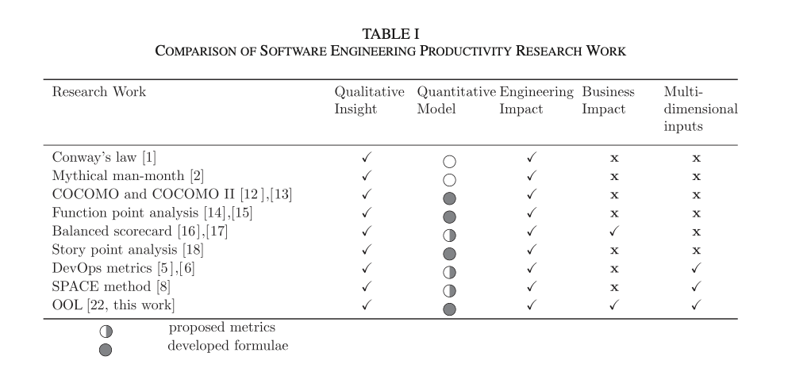

# P0017 — Organizational Ohm's Law in Practice: Measuring Engineering Productivity

**Authors:** F. Liu; T. McKinnon
**Venue:** IEEE Transactions on Engineering Management
**Year (publication):** 2024
**DOI:** 10.1109/TEM.2024.3421892
**PDF:** pdfs/IEEE/Organizational_Ohms_Law_in_Practice_Measuring_Engineering_Productivity.pdf

> Blind coding: fill in only from the source text, without consulting Claude/NotebookLM.

---
## RECORD (spreadsheet fields — fill in after the colon)

- Relevance [Include/Exclude/Unsure]: Include
- Exclusion Reason (only if Exclude): 
- Primary or Secondary [Primary/Secondary]: Primary
- Study Type [Experiment/Quasi-experiment/Case study/Survey/Qualitative-Interviews/Review-Secondary/Experience report/Repository mining/Mixed methods/Other]: Case study (multiple-case, n=4; mixed objective/subjective metrics)
- Research Method: Multiple-case study applying/validating the quantitative Organizational Ohm\'s Law; LOC (Git) output, usage-based business impact (logs/revenue) outcome, time allocation/motivation/skill (questionnaire) inputs; tests linear relationship
- Context (industry/OSS/academic + sample): industry; 4 software product-feature projects (authors from Okta)
- DORA Applied [Yes/No]: No 
- SPACE Applied [Yes/No]: No
- AI Discussed [Yes/No]: Yes
- Mentions Remote/COVID [Yes/No]: No
- Data time window (e.g., 2018–2019 / not reported / review coverage): NDA

Metric categories:
- Productivity/Performance [Yes/No]: Yes
- Quality [Yes/No]: No
- Collaboration [Yes/No]: No
- Satisfaction/Wellbeing [Yes/No]: Yes
- Activity/Code [Yes/No]: Yes
- Delivery Performance [Yes/No]: No
- DevEx Dimensions [Yes/No]:  No
- Agile/Process [Yes/No]: Yes
- Survey/Perceptual [Yes/No]: Yes

- Confidence [High/Medium/Low]: High
- Quality Score [1–5, mean of the 6 Dybå & Dingsøyr criteria]: 5

---
## DETAIL (free text)

### Pandemic / remote work (elaborate)
- Measurement motivated/adapted to remote work? Before/after comparison? Associated dimensions? Direction code-centric vs human-centered?
- 

### Evidence (quotes with section/page) — required
- "quantitatively explore the use
of organizational Ohm’s law to measure productivity in software
engineering" — 

- "According to this law, organizational productivity is
directly proportional to outcome–output efficiency and organi-
zational potential, while inversely proportional to organizational
resistance"

- "We derive measurable metrics from this law, which in-
clude engineer time allocation, engineer motivation, engineer skills,
outcome–output alignment, lines of code, and usage-based business
impact.

- "We propose various practical methods to obtain these
metrics and explain the considerations to determine the appropri-
ate methods"

- "We apply
the law to measure the engineering productivity of the projects"

- "Our
research supports the validity of organizational Ohm’s law using
lines of code output and usage-based business impact outcome."

- "Our
work demonstrates that organizational Ohm’s law could provide
an effective and intuitive model for understanding engineering
productivity challenges."

- "Recent software development and management studies and
practices, such as story points [18], scaling agile@Spotify [19],
and the two-pizza rule [3], are developer centric and built on
DevOps and agile concepts"

- "The industry software productivity
or engineering velocity best practices are practical, valuable,
and widely adopted, but typically only focus on particular as-
pects of productivity and are hard to prove scientifically and
learn by other organizations [20]"

- "Over the past several years,
studies, such as DevOps metrics [5], [6] and a SPACE method
[8], emphasize that developer productivity is influenced by
multidimensional input metrics, such as developer satisfaction
and well-being. However, the studies do not connect the input
metrics with a formulable relationship to help understand their
inter-relationship"

- "We identify metrics that can be measured objectively or subjec-
tively to represent the variables in the quantitative OOL. Second,
we choose four software product development projects to study
and document the details of the projects. Third, we apply the
quantitative OOL to the selected projects. We evaluate various
approaches to collect the OOL metrics, discuss their pros and
cons, and choose the most suitable approaches to obtain them"

- "In contrast to Ohm’s law in electrical engineering, where
variables are independent, the input variables on the right side
of (2) may be interdependent. For instance, if more engineers
are added to a project, it would increase the time required for
the team to collaborate, resulting in a decrease in the percentage
of time spent on core engineering development. Eliminating en-
gineering or company processes would increase the percentage
of time spent on core engineering development but could pose
risks in terms of aligning a project with its goal or motivating
and upskilling engineers"

- "From a research perspective, these projects
represent large-scale, modern industry software product de-
velopment. We can gather valuable datasets, conduct system-
atic studies, and gain practical insights by examining these
projects."

- "Evaluating Approaches and Measuring LOC Output: Let
us first evaluate the output of software development projects.
One commonly used metric is LOC. While LOC-based mea-
surement has many limitations, it is an easy-to-obtain objective
measure and can be referenced in project management literature.
Therefore, we include LOC as an output metric in this study."

- "To collect historical LOC data, we asked engineering leaders
to extract the information from Git repositories at various project
stages, including project start, feature EA stages, GA stages, and
the dates of the input metrics questionnaire collected. Some of
the project code is a part of core components shared by multiple
projects or coexists with the code of other projects. The leaders
employed an approximate approach to count LOC belonging to
their projects and contributed by their teams. Fig. 2 shows the
LOCs of the four features at the three stages of the product-
feature lifecycles: project start, EA, and GA. Note that all the
engineering teams continue to develop these features after GA.
However, for the sake of simplicity, Fig. 2 does not include the
data after GA."

- "Evaluating Approaches and Measuring Business Impact
Outcome: Measuring the business impact of product features
can be done by looking at the feature’s contribution to the
company’s revenue over its lifetime. However, not all product
features have their own unique stock keeping units. Some are
packaged as a part of pricing bundles, and some are discounted
for specific contracts. These make it challenging to separate
intrinsic individual feature revenue contributions. Another way
to obtain feature revenue contribution is by multiplying the
amount of feature usage by its equivalent unit price, i.e., rev-
enue equal to the number of units multiplied by unit price.
This approach has several advantages. First, it provides a rela-
tively objective metric. Second, historical and real-time feature
usage data can be obtained objectively from product system
logs. Third, building features that customers find valuable to
use emphasizes a customer-centric view and creates long-term
business value. Fourth, it solves product pricing bundling is-
sues. Additionally, it may align with a usage-based pricing
model."

- "We obtained each project’s accumulated business impact over
the one year after GA. Then, we discounted the value to the
start dates of the projects using an annual discount rate of 12%.
We plotted the normalized discounted accumulated business
impact (in units of the number of organizations∗$) for the four
features in Fig. 3. In short, we use the normalized discounted
accumulated business impact one year after GA as the outcome
metric, as shown in the usage-based business impact row of
Table II."

- "1) Determining Time Duration to Achieve LOC Output:
When determining the time duration to achieve LOC output,
there is a direct relationship between LOC and the time it takes
to write the LOC. Therefore, the time duration it takes to achieve
the LOC at GA stages is equal to the project duration between
the start of projects and their GA dates.
2) Evaluating Approaches and Determining Time Duration
to Achieve Business Impact Outcome: When determining the
time duration required to achieve a business impact outcome, we
need to take into account the project’s development process."

- "1) Determining Outcome–Output Efficiency of LOC: For the
outcome–output efficiency of LOC, since the output of soft-
ware engineering is to produce quality code, LOC output can
be thought of as a special-case outcome with an outcome–
output alignment equal to output–output alignment, with a
value of 1.
2) Evaluating Approaches and Measuring Outcome–Output
Efficiency of Business Impact Outcome: Now, let us measure
the outcome–output efficiency for the business impact outcome.
For the software product features we study, their goal is to
deliver product features that customers love and generate the
best business value. The business impact outcome metric we
discussed in Section IV-C2 is a representation of the business
goal."

- "1) Testing LOC Scenario: To calculate output current, we
divided LOC by project duration, as shown in the output current
per year row in Table II. The numbers represent the left hand
of (2). We multiply the percentage of time spent on coding and
testing, relative motivation scores, and relative skill scores, as
shown in the input product of the output scenario row in Table II.
The numbers represent the right hand of (2), except the constant
k."

- "2) Testing Business Impact Scenario: To calculate the out-
come current, we divided business impact by equivalent project
duration, as shown in the outcome current row per year in
Table II. The numbers represent the left-hand side of (2). We
multiply outcome–output alignment scores, the percentage of
time spent on coding and testing, engineer motivation scores, and
engineer skill scores, as shown in the alignment∗input product
of the outcome scenario row in Table II. The numbers represent
the right-hand side of (2), except the constant k."

- "OOL provides the connection between input metrics and out-
put metrics. In this study, LOC and usage-based business impact
are chosen as output and outcome metrics, and the percentage of
time spent in activities, skill, and motivation scores are used as
input metrics. However, OOL could be more universal than the
metric combination examples we study in this work. Goals can
be set for a project from financial, customer, internal operation,
and employee learning and growth perspectives [17]. For exam-
ple, story points, customer satisfaction scores, lifetime direct and
indirect revenue of product features, or public benefits generated
by nonprofits may be selected as output or outcome metrics,
and one or a combination of DevOps Research and Assessment
metrics may be used to represent infrastructure resistance [33].
Employee satisfaction scores, management ratings, and turnover
rates may be used to reflect individual motivation or skills."

- "ne purpose of the work is to formulate a quantitative OOL
and test its validity. Therefore, we derive the quantitative OOL
with measurable metrics from the original OOL variables, obtain
the value of the metrics on both the left hand and right hand
of (2), and test whether there is a linear relationship between
the right-hand-side variables and the left-hand variables of the
equation."

### Quality (Dybå & Dingsøyr — score each criterion 1–5; score = mean)
- Clarity of research objectives: 5
- Methodological adequacy: 5
- Description of sample and context: 5
- Discussion of threats to validity: 5
- Sufficiency of reported evidence: 5
- Contribution to practice or theory: 5 

### Free notes (if secondary study/review, note here)

- Its a very good research, using a new metric mapping input with output to get one equation that measuring engineering productivity. The authors are CEO of big company OKTA.

- Its very different approach of others papers that commom uses DORA, Space and DEvEx but uses a very cientific process and approachs.

- The data to validate approach is properly used and builted, selected the four most significant product-feature development projects.
